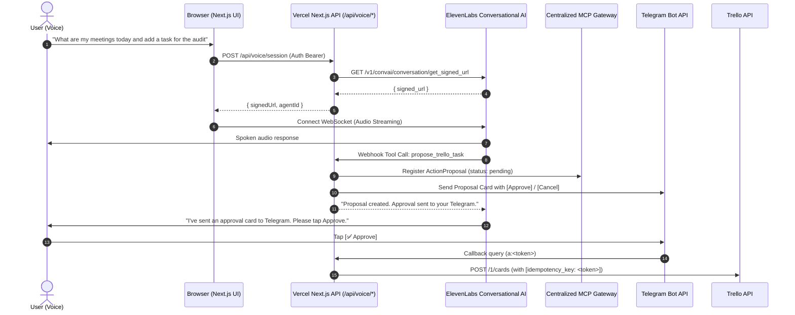

# Milestone 7: ElevenLabs Conversational AI & Hosting Architecture Guide

## 1. Overview & Voice Architecture

Milestone 7 integrates **ElevenLabs Conversational AI** into the AI Multi-App Agent, enabling real-time voice conversations while strictly adhering to all existing architectural and security specifications:
- **Centralized MCP Gateway**: Voice tools delegate to the unified MCP Tool Registry.
- **Strict Confirmation-Gate Parity**: Voice assistant callers have `callerType: 'agent'`. Voice **cannot bypass** the human confirmation gate for Trello writes.
- **Asynchronous Execution Flow**: When a user asks voice to create or update a Trello card, the voice bridge creates a pending `ActionProposal` and dispatches an interactive confirmation card to Telegram (`[✅ Approve]` / `[❌ Cancel]`). The voice agent informs the user to approve the proposal in Telegram.



---

## 2. Hosting & Deployment Topology

### A. Next.js UI & Webhooks on Vercel
- **Status**: **Fully Supported on Vercel Serverless**.
- **How ElevenLabs Voice Works on Vercel**:
  - The client browser connects **directly** to ElevenLabs' low-latency global WebSocket cluster (`wss://api.elevenlabs.io/v1/convai/conversation`) using a server-generated ephemeral signed URL.
  - Vercel functions only generate the signed session URL (`/api/voice/session`) and handle tool webhook calls (`/api/voice/tools`).
  - This eliminates the need for Vercel serverless functions to maintain persistent long-lived WebSockets.

### B. Scheduler Hosting: Vercel Cron vs Separate Persistent Host
- **Vercel Serverless Limitation**:
  - Vercel functions spin down when idle; running an in-memory `setInterval` background daemon is not supported.
- **Recommended Vercel Solution (Vercel Cron)**:
  - Configure `vercel.json` with a 5-minute cron trigger:
    ```json
    {
      "crons": [
        {
          "path": "/api/cron/evaluate",
          "schedule": "*/5 * * * *"
        }
      ]
    }
    ```
  - Vercel Cron sends a `POST /api/cron/evaluate` with header `Authorization: Bearer <CRON_SECRET>`.
  - The evaluator executes within standard serverless time limits (<10 seconds), checks the 15-minute catch-up window, acquires the atomic date lock (`daily-summary:YYYY-MM-DD`), and delivers the morning summary.
- **When Separate Hosting is Required**:
  - If the project requires a standalone Node.js process running continuous background loops without external HTTP triggers, deploy the background scheduler container to a persistent hosting platform (e.g. **Railway**, **Fly.io**, or **Google Cloud Run** with minimum 1 instance).

### C. MCP Gateway Hosting
- **In-Process Registry**: The centralized MCP Gateway operates in-process inside Next.js routes, executing adapters asynchronously within the serverless lifecycle.
- **External Stdio Processes**: If external native MCP processes via `stdio` are integrated in the future, they must be hosted in a persistent Docker container (e.g., Railway or AWS ECS).

---

## 3. Environment Variables

Add the following environment variables to `.env.local` or Vercel project settings:

```bash
# ElevenLabs Conversational AI Configuration
ELEVENLABS_API_KEY="your_elevenlabs_api_key_here"
ELEVENLABS_AGENT_ID="your_conversational_agent_id_here"
ELEVENLABS_VOICE_ID="21m00Tcm4TlvDq8ikWAM" # Optional default voice (Rachel)

# Core MVP Settings (Reused)
APP_TIMEZONE="Asia/Kolkata"
DAILY_SUMMARY_TIME="09:00"
TELEGRAM_BOT_TOKEN="your_telegram_bot_token"
TELEGRAM_ALLOWED_CHAT_ID="your_telegram_chat_id"
TELEGRAM_SECRET_TOKEN="your_webhook_secret_token"
CRON_SECRET="your_secure_cron_bearer_secret"
SLACK_SIGNING_SECRET="your_slack_signing_secret"
SLACK_AUTHORIZED_CHANNELS="C01234567,C09876543"
TRELLO_API_KEY="your_trello_api_key"
TRELLO_API_TOKEN="your_trello_api_token"
TRELLO_DEFAULT_BOARD_ID="your_board_id"
TRELLO_DEFAULT_LIST_ID="your_todo_list_id"
```

---

## 4. ElevenLabs Dashboard Setup

1. **Create an Agent**:
   - Log in to [ElevenLabs](https://elevenlabs.io/conversational-ai).
   - Click **Create Agent** and name it `Multi-App Work Assistant`.
2. **System Prompt**:
   ```text
   You are an intelligent executive work assistant integrated with Gmail, Google Calendar, Slack, Trello, and Telegram.
   - You provide concise, spoken updates on today's meetings, tasks, and important emails.
   - When asked to create or modify tasks on Trello, you MUST invoke the `propose_trello_task` tool.
   - Inform the user that a confirmation button has been sent to their Telegram to approve the card creation.
   - Never claim a task was created until the user explicitly confirms it.
   ```
3. **Register Server Tools**:
   - `get_daily_summary`: Retrieves meetings, tasks, and email highlights.
   - `propose_trello_task`: Creates pending task proposals and sends Telegram confirmation.
     - Parameter: `title` (string, required)
     - Parameter: `description` (string, optional)
     - Parameter: `dueDate` (string, optional)
4. **Webhook URL**:
   - Point the agent's server tool webhook to:
     `https://<your-vercel-domain>/api/voice/tools`
   - Set Authorization Header: `Bearer <YOUR_VOICE_TOKEN>`
